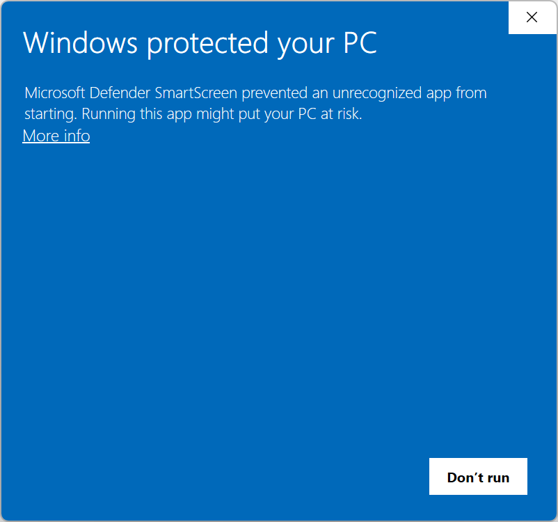
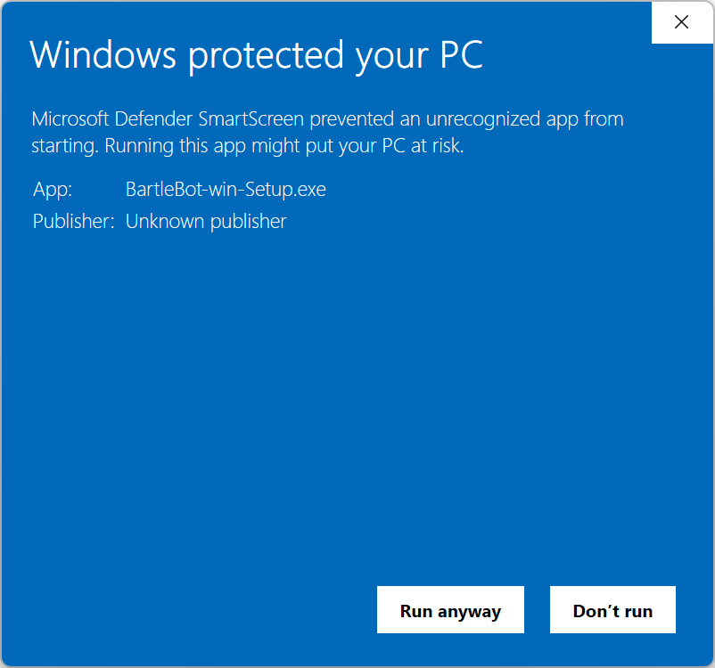

<h1> BartleBot</h1>

A Wizard101 bot for the repetitive parts of the game: farming dungeons, gathering, and the
fights in between. BartleBot is in public beta.

<!-- install:start -->
## Installing BartleBot

You need 64-bit Windows 10 or 11 and Wizard101.

1. Download **BartleBot-win-Setup.exe** from the
   [latest release](https://github.com/The-World-Tree/BartleBot/releases/latest).
2. Run it. It installs BartleBot for your Windows account only, and neither installing
   nor running it needs an administrator. It puts BartleBot on your Desktop and in the
   Start Menu, then opens BartleBot's setup, which finds your game, adds your accounts,
   and copies the game's art from your own install.

Windows will probably warn you about the download first, because BartleBot is not
code-signed. What each warning means is below.

### "Windows protected your PC"

This is SmartScreen, which warns about any program that is not code-signed and has not been
downloaded by many people yet. Select **More info**, then **Run anyway**. It asks only
once: updates are downloaded by BartleBot itself, and Windows does not warn about those.




### Smart App Control

Smart App Control is in Windows 11 only. If it is on, Windows blocks BartleBot every time it starts, not only when
you install it. It has no way to allow a single program, so **BartleBot only runs with
Smart App Control turned off**, and it has to stay off. To turn it off, open **Windows
Security**, then **App & browser control**, then **Smart App Control settings**, and
select **Off**. Turning it off no longer means reinstalling Windows. If you would rather
keep Smart App Control on, BartleBot is not for this PC.

### Antivirus

An antivirus program may flag BartleBot. It reads and writes the game's memory, which is
how it knows where you are and what is happening in a fight, and malware does the same
thing. Every release is sent to Microsoft for review. We will never ask you to turn your
antivirus off or to add an exclusion for BartleBot. If yours removes it, please
[open an issue](https://github.com/The-World-Tree/BartleBot/issues) saying which
antivirus it was.

### Updates

BartleBot checks for a new version each time it starts, and asks before installing it. An
update installs when you close BartleBot, or right away if you choose **Restart now**,
and never while a bot is running.

### Where your data is, and uninstalling

| folder | what is in it |
|---|---|
| `%LocalAppData%\BartleBot` | BartleBot itself, replaced whole by each update |
| `%APPDATA%\Bartleby\BartleBot` | your settings, your bots, and BartleBot's logs |
| `%APPDATA%\Bartleby` | your accounts and your combat strategies, shared by every Bartleby app |
| `%LocalAppData%\Bartleby` | caches and downloaded updates, which are rebuilt when needed |

Your passwords are in Windows Credential Manager, never in a file.

To uninstall, open **Settings**, then **Apps**, then **Installed apps**, and select
**Uninstall** next to BartleBot. It removes the program and keeps all of your data, so
reinstalling picks up where you left off. To remove your BartleBot data too, delete
`%APPDATA%\Bartleby\BartleBot` afterwards. Delete the rest of `%APPDATA%\Bartleby` only if
you use no other Bartleby app.
<!-- install:end -->

## Running from source

For working on BartleBot itself. You need Python 3.13 or newer and
[uv](https://docs.astral.sh/uv/getting-started/installation/).

```powershell
uv sync
uv run python bartlebot.py
```

`CLAUDE.md` covers the rest: developer mode, the tests, and how the code is laid out.
BartleBot is built on [WizWalker](https://github.com/The-World-Tree/wizwalker) and
[WizSprinter](https://github.com/The-World-Tree/wizsprinter).

## License

Copyright (C) 2026 BartleBot

This program is free software: you can redistribute it and/or modify it under
the terms of the GNU General Public License as published by the Free Software
Foundation, either version 3 of the License, or (at your option) any later
version.

This program is distributed in the hope that it will be useful, but WITHOUT ANY
WARRANTY; without even the implied warranty of MERCHANTABILITY or FITNESS FOR A
PARTICULAR PURPOSE. See the GNU General Public License for more details.

You should have received a copy of the GNU General Public License along with
this program. If not, see <https://www.gnu.org/licenses/>.
