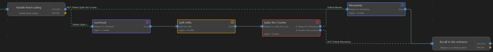
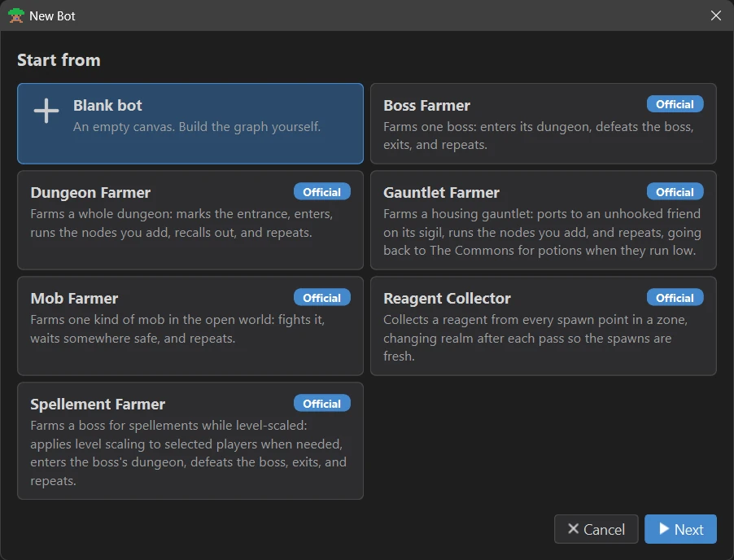
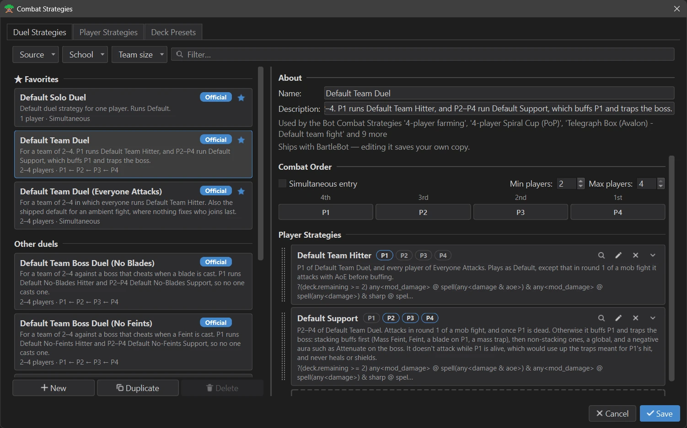
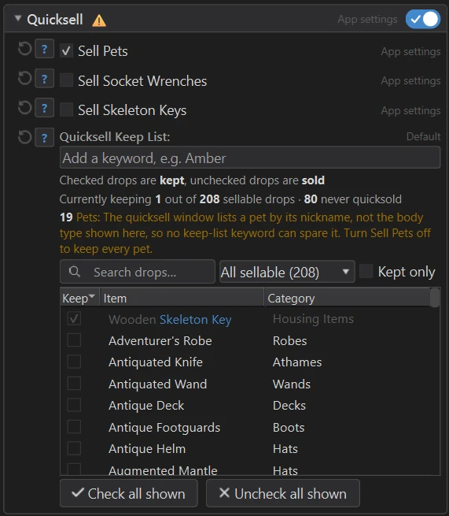

## Why BartleBot?

- **Robust failure recovery** Bots reliably run overnight, even through failed zone loading screens, internet disconnects, and game crashes.
- **Combat system overhaul** New features and improvements to combat behavior, configurable per-bot combat profiles that include duel and player-specific strategies, and saving/loading decks.
- **Code-free state machine editor** Create bots by recording in-game actions instead of writing code, while retaining the ability to perform advanced behaviors via configurable options and control flow features.
- **Extensive reuse** Use libraries of common flows and actions, automatic updates, and other features from modern architectures.
- **Quality-of-life features** Quicksell handling, auto-grouping, and more!

## Every bot is a graph you can read

A bot is a chain of steps: enter the dungeon, defeat the boss, collect the wisps. Every
step ends in success or failure, and its edges say what happens next, so a bot knows what
to do when a step goes wrong.

{ .bb-shot }

## Start from a template

New Bot starts from a template: farm a boss, a whole dungeon, a housing gauntlet, a mob in
the open world, reagents or spellements. Official templates are tested in game, and when
one improves, the bots made from it are offered the update.

{ .bb-shot }

## Combat that fits the fight

Every fight runs a duel strategy: the order your wizards join in, and what each of them
casts. BartleBot ships defaults for solo and team fights, and for bosses that cheat when
a blade or a Feint is cast. Change any of them and BartleBot keeps your own copy.

{ .bb-shot }

## Keep what you want, sell the rest

Quicksell sells the drops you don't want as part of the run. Check the ones to keep and
the rest are sold. Each bot comes with its own keep list, and you can change it.

{ .bb-shot .bb-shot--narrow }

!!! info "BartleBot is currently in public beta"

    If something goes wrong, please [open an issue](https://github.com/BartleWorks/BartleBot/issues) with as much information as possible, including any log files from the session where the issue occurred.
