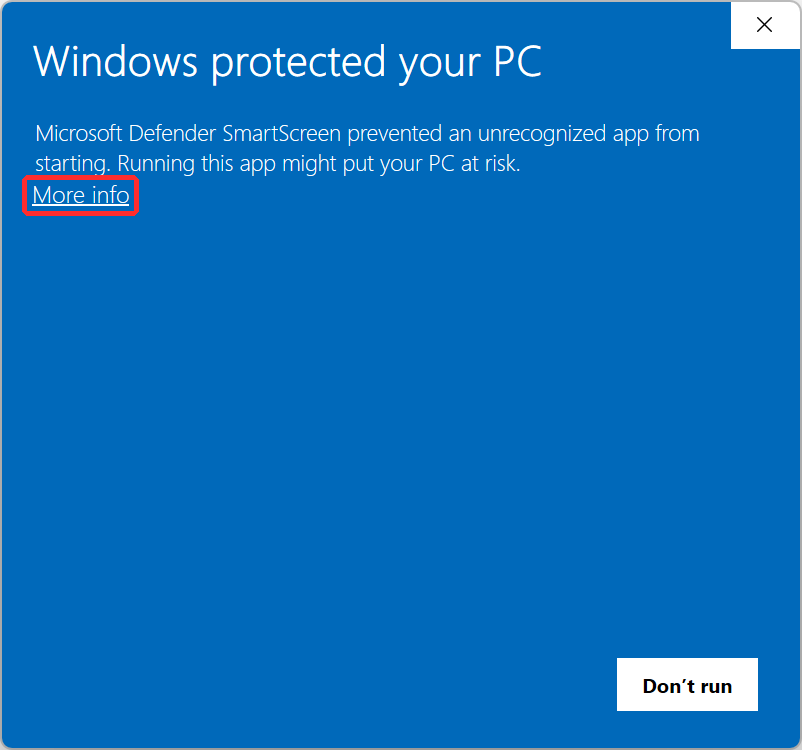
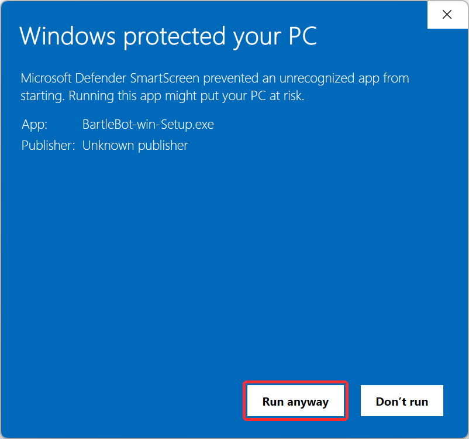
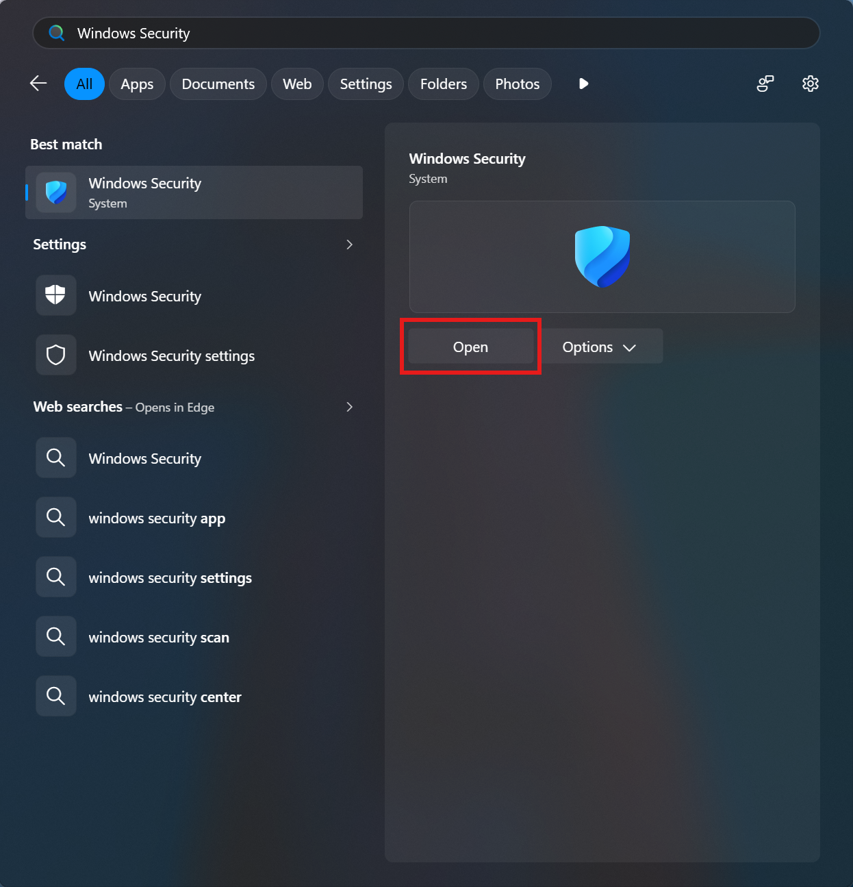
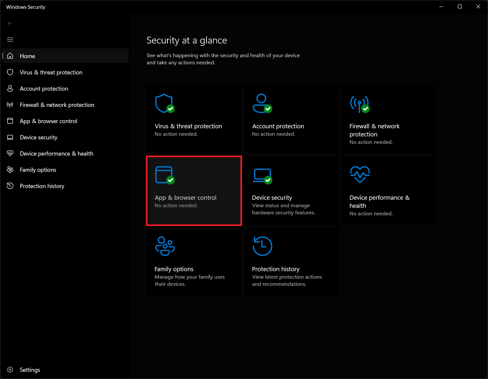
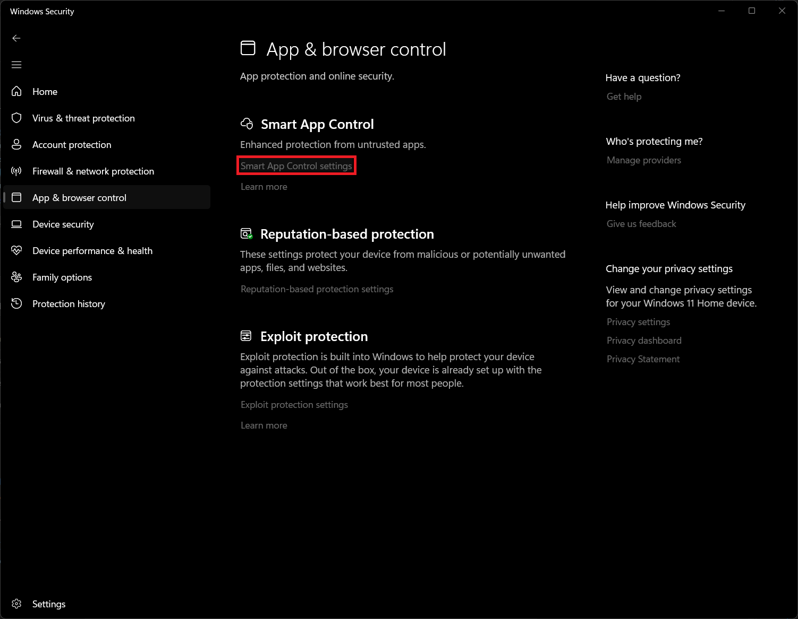
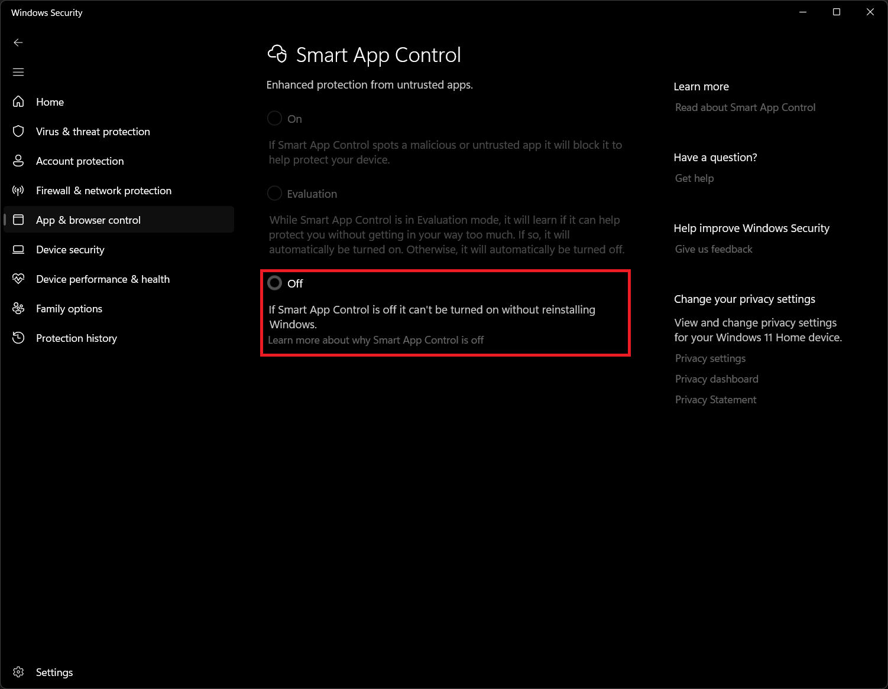

# Installing BartleBot

BartleBot is available for 64-bit Windows 10 or 11, and requires an existing Wizard101 installation.

1. Download **BartleBot-win-Setup.exe** above, or from the
   [latest release](https://github.com/BartleWorks/BartleBot/releases/latest).
2. Run **BartleBot-win-Setup.exe**. It puts BartleBot on your Desktop and in the
   Start Menu, then opens BartleBot's setup, which finds your game, adds your accounts,
   and copies the game's art from your own install.

## Common Issues

BartleBot isn't officially registered and code-signed, and it interacts with Wizard101 by reading and writing memory. Because of this, downloading and running BartleBot can often cause Windows or an antivirus program to flag it. Below are some common issues that users may encouter while downloading, installing, and running BartleBot.

### SmartScreen: "Windows protected your PC"

SmartScreen warns about any program that is not code-signed and has not been downloaded by many people yet. This should only ever be encountered upon a new installation.

1. Select **More info**

    

2. Select **Run anyway**

    

### Smart App Control

Smart App Control is in Windows 11 only. If it's on, Windows will block BartleBot every time it starts. It has no way to allow a single program, so **BartleBot can only run with Smart App Control turned off**. If you would rather keep Smart App Control on

1. Open **Windows Security**

    

2. Click **App & browser control**

    

3. Click **Smart App Control settings**

    

4. Select **Off**.

    

### Antivirus

BartleBot reads and writes the game's memory to access the game state. This may cause antivirus software to falsely flag it as malware, since many malware programs also read and write memory. You can view the BartleBot source code [here](https://github.com/BartleWorks/BartleBot) to confirm its behavior yourself.

Every release is sent to Microsoft for review. We will never ask you to turn your antivirus off or to add an exclusion for BartleBot. If yours removes it, please [open an issue](https://github.com/BartleWorks/BartleBot/issues) saying which antivirus it was.

## Updates

BartleBot checks for a new version each time it starts, and asks before installing it. An update installs when you close BartleBot, or right away if you choose **Restart now**, and never while a bot is running.

## Where your data is, and uninstalling

| Folder                         | Contents                                                               |
| ------------------------------ | ---------------------------------------------------------------------- |
| `%LocalAppData%\BartleBot`     | BartleBot itself, replaced whole by each update                        |
| `%APPDATA%\Bartleby\BartleBot` | your settings, your bots, and BartleBot's logs                         |
| `%APPDATA%\Bartleby`           | your accounts and your combat strategies, shared by every Bartleby app |
| `%LocalAppData%\Bartleby`      | caches and downloaded updates, which are rebuilt when needed           |

Your passwords are in Windows Credential Manager, never in a file.

To uninstall, open **Settings**, then **Apps**, then **Installed apps**, and select **Uninstall** next to BartleBot. It removes the program and keeps all of your data, so reinstalling picks up where you left off. To remove your BartleBot data too, delete `%APPDATA%\Bartleby\BartleBot` afterwards. Delete the rest of `%APPDATA%\Bartleby` only if you use no other Bartleby app.
